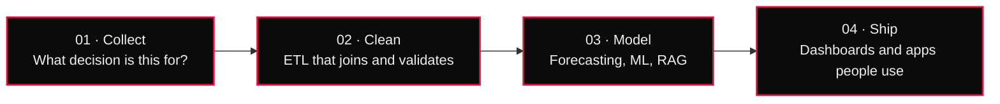

  

  

  
  
  
  
  

  

---

## 👋 About me

I'm a data scientist in Bhubaneswar. I build forecasting models, ML pipelines and generative-AI tools that point at a real decision, not just a benchmark.

I'm a final-year B.Tech CSE student at **XIM University**, working across the full ML stack: classical forecasting, deep learning and generative AI, with the same care from the first notebook to the deployed dashboard.

- 📍 Bhubaneswar, Odisha, India
- 🎯 Open to **data science, ML and Gen-AI** roles and internships
- ☕ Runs on Python, SQL, notebooks and too much chai

 

### 📈 Impact so far

  
  
  
  

---

## 🧭 How I work

---

## 💼 Experience

<b>Web3 Developer Intern</b> · Entrust Software Development, Ahmedabad · <i>Jul 2026 – Sep 2026</i>

 

- Built frontend screens in React and TypeScript, with wallet connection through Reown AppKit and ethers.js.
- Developed REST APIs in Node.js and Express with PostgreSQL, JWT authentication and role-based access.
- Wrote and tested Solidity smart contracts with Hardhat and OpenZeppelin, including an ERC-20 token factory.
- Containerised the app with Docker Compose and hardened it with Zod validation, rate limiting and Helmet.

     · <a href="https://drive.google.com/file/d/1K4yGczPc1WR3h53WEegEAl-SNGY68vVi/view">Certificate ↗</a>

<b>Data Analyst Intern</b> · BHPPL, Tavasya, Himachal Pradesh · <i>May 2026 – Jun 2026</i>

 

- Built an end-to-end ML forecasting model on daily hydroelectric generation logs, improving predictive accuracy by **18%**.
- Built SQL-based ETL pipelines over 10,000+ daily metrics, removing **25 hours** of manual data wrangling per week.
- Developed Power BI dashboards that cut reporting turnaround by **40%** and surfaced operational bottlenecks.

    · <a href="https://drive.google.com/file/d/1GnP4KYa34GQOju80Xg2pL9t_xHfveQi5/view">Certificate ↗</a>

<b>Leadership</b> · ACM Student Chapter and Class Representative

 

- **Events Lead**, ACM Student Chapter, XIM University · Apr 2024 – Apr 2025
- **Class Representative**, B.Tech CSE Batch 2023–2027, XIM University · Aug 2023 – present

---

## 🚀 Selected work

<table>
<tr>
<td width="50%" valign="top">

### 📬 MailMind
<b>AGENTIC AI · RAG</b>

An agentic RAG assistant for job hunting. It reads a job post, searches your resume, drafts a personalised cold email, then reviews and rewrites it. It also finds openings with Apify, ranks them against your resume, and tracks replies and follow-ups from Gmail.

`Python` `Qwen (Groq)` `RAG` `Streamlit` `Apify`

<a href="https://github.com/SurajMhrn/MailMind">Repo ↗</a>

</td>
<td width="50%" valign="top">

### ⛓️ Web3 Platform
<b>FULL-STACK · BLOCKCHAIN</b>

Wallet-linked accounts, role-based admin, an ERC-20 token factory, transaction history, notifications and analytics in one platform. Built during the Entrust internship with React, Express, PostgreSQL and Solidity on Sepolia, all in Docker.

`React` `Node.js` `PostgreSQL` `Solidity` `Docker`

<a href="https://web3-platform-beta.vercel.app">Live demo ↗</a>

</td>
</tr>
<tr>
<td width="50%" valign="top">

### ⚡ EV Charging Demand Forecaster
<b>TIME-SERIES FORECASTING</b>

Forecasts EV charging demand with ARIMA and Prophet, combining historical usage, weather and traffic data. Tableau dashboards show peak load and demand curves for grid management and energy distribution.

`Python` `ARIMA` `Prophet` `Power BI` `Tableau`

<a href="https://github.com/SurajMhrn/EV-Charging-Demand-Forecaster">Repo ↗</a>

</td>
<td width="50%" valign="top">

### 🤖 UniBot
<b>GENERATIVE AI · LLM</b>

A RAG-based university chatbot that answers student questions on admissions, curriculum and campus events. LangChain and Mistral retrieve answers from a ChromaDB vector store, served through Streamlit.

`Python` `LangChain` `Mistral` `ChromaDB`

<a href="https://github.com/SurajMhrn/University_Chatbot">Repo ↗</a>

</td>
</tr>
<tr>
<td width="50%" valign="top">

### 📊 Learning Intelligence Suite
<b>PREDICTIVE ANALYTICS · EDTECH</b>

A Random Forest model that forecasts course completion and flags high-risk students from engagement metrics. A Streamlit dashboard shows chapter difficulty and score volatility to guide curriculum decisions.

`Python` `scikit-learn` `Streamlit`

<a href="https://github.com/SurajMhrn/Learning-Intelligence-Suite">Repo ↗</a>

</td>
<td width="50%" valign="top">

### 🔥 LinkedIn Job Trends
<b>WEB SCRAPING · ANALYSIS</b>

Scrapes LinkedIn job posts to map which skills are in demand, for which roles, in which cities. Pandas builds a skill-versus-role matrix and Seaborn heatmaps turn it into recommendations for job seekers.

`Python` `BeautifulSoup` `Pandas` `Seaborn`

<a href="https://github.com/SurajMhrn/LinkedIn-Job-Trend-Scraper">Repo ↗</a>

</td>
</tr>
</table>

<b>More things I've shipped</b> (click to expand)

 

- **[Spendlens](https://spendlens-one.vercel.app)**: expense tracker with budgets, overspend alerts and mood-tagged spending
- **[Cold Mail](https://cold-mail-blue.vercel.app)**: earlier web version of the cold-email generator
- **[FoodiXpress](https://foodi-xpress-azure.vercel.app)**: food-delivery web app to browse cuisines, order and track deliveries
- **[RobogeniX](https://robogeni-x.vercel.app)**: robotics landing site
- **[Smart Choice](https://github.com/SurajMhrn/Smart-Choice-Gadget-Recommendation-System)**: gadget recommendation system that filters by specs, price and brand

---

## 🛠️ Toolkit

  

<b>Full stack, by area</b> (click to expand)

 

**Languages:** Python, SQL, Java, C, TypeScript, Solidity

**ML & DL:** scikit-learn, TensorFlow, PyTorch, Random Forest, time-series forecasting, ARIMA, Prophet

**Generative AI:** Transformers, LLMs, RAG systems, LangChain, fine-tuning, prompt engineering

**Data & BI:** NumPy, Pandas, Matplotlib, Seaborn, Power BI, Tableau, Streamlit

**Databases:** MySQL, PostgreSQL, MongoDB, SQLite, ChromaDB

**Web & tools:** Django, Flask, React, Node.js, Hardhat, Docker, Git, Jupyter

---

## 🏆 Honours, certifications and education

<b>Honours</b>

 

- 🥇 **Winner, ICAIET 2025 Exhibition**: first place for project showcase at an IEEE conference
- 🥇 **Winner, The Innovation Challenge**
- **Megatron**, Synchronize 3.0
- **Graduation Scholarship (2023)** for outstanding academic performance in Class XII

<b>Certifications</b>

 

- **Data Analytics with Python (Elite)**, NPTEL, IIT Roorkee · 12-week course
- **Data Science Course**, Code With Harry
- **Workshop on Blockchain & Cloud Security**
- **Certificate of Leadership**, IAJES participation

<b>Education</b>

 

- **XIM University, Bhubaneswar**: B.Tech (Hons.) CSE · 2023 – 2027 · CGPA 8.43
- **Khallikote Higher Secondary School**: Class XII, Science · 2020 – 2022 · 71.5%
- **SSVM, Berhampur**: Class X · 2018 – 2020 · 74.33%

---

## 📊 GitHub activity

  
  

  

  

  <picture>
    <source media="(prefers-color-scheme: dark)" srcset="https://raw.githubusercontent.com/SurajMhrn/SurajMhrn/output/github-snake-dark.svg" />
    <source media="(prefers-color-scheme: light)" srcset="https://raw.githubusercontent.com/SurajMhrn/SurajMhrn/output/github-snake.svg" />
    
  </picture>

---

  <b>Have a problem worth modelling?</b> 
  <a href="mailto:surajscs159@gmail.com">surajscs159@gmail.com</a> · <a href="https://suraj-maharana.vercel.app">suraj-maharana.vercel.app</a>

  

